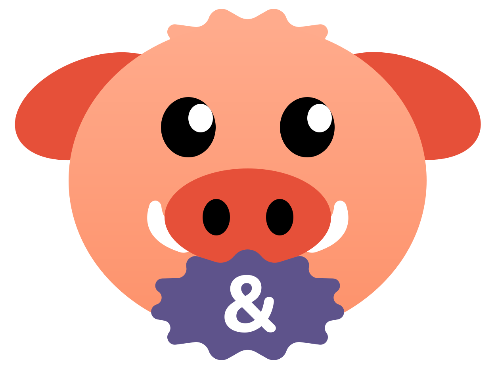

[](https://github.com/BorrowSanitizer/bsan/actions/workflows/ci.yml) [](https://borrowsanitizer.github.io/bsan/) [](https://borrowsanitizer.com) [](https://bsan.zulipchat.com/) [](https://vscode.dev/redirect?url=vscode://ms-vscode-remote.remote-containers/cloneInVolume?url=https://github.com/BorrowSanitizer/bsan)

# BorrowSanitizer


 
BorrowSanitizer is a work-in-progress LLVM instrumentation pass for detecting aliasing violations in multi-language Rust applications. Our project is still in early development, but may help you find cross-language bugs otherwise undetectable by Miri. Our goal is to support detecting the following types of errors:

* Violations of Rust's [*Tree Borrows*](https://perso.crans.org/vanille/treebor/) aliasing model.
* Accesses out-of-bounds
* Use-after free errors.

Check out [our website](https://borrowsanitizer.com) for more information.

## Usage
The easiest way to try BorrowSanitizer is inside a Docker container. Our image supports the following platforms:

|   **Platform**    |         **Target**            | **Description**            |
|-------------------|-------------------------------|----------------------------|
|   `linux/amd64`   | `aarch64-unknown-linux-gnu`   |ARM64 Linux                 |
|   `linux/arm64`   |  `x86_64-unknown-linux-gnu`   |X86 Linux                   |

First, pull our [latest image](https://github.com/BorrowSanitizer/bsan/pkgs/container/bsan) from GitHub's container registry.
```
docker pull ghcr.io/borrowsanitizer/bsan:latest
```
Then, launch a container and attach a shell.
```
docker run -it bsan:latest
```
Once inside the container, you can use our Cargo plugin to build and test crates using BorrowSanitizer. 
```
cargo bsan test
```
Our plugin supports most of the same subcommands as Miri. When it's used for the first time, it will perform a one-time setup step of building an instrumented sysroot. You can trigger this step manually using the `setup` subcommand. 

## Contributing
We follow the LLVM Project's [AI Tool Use Policy](https://llvm.org/docs/AIToolPolicy.html). All AI-generated content must be disclosed. There must always be a human in the loop. 

We welcome contributions! Please consult our [contribution guide](https://github.com/BorrowSanitizer/bsan/blob/main/CONTRIBUTING.md) and join [our Zulip](https://bsan.zulipchat.com/) if you have questions.

## Bugs found by BorrowSanitizer

BorrowSanitizer has been used to find a variety of new cross-language aliasing bugs in open source projects. 
* [Overlapping references in `aws-lc-rs`](https://github.com/aws/aws-lc-rs/pull/1288)
* [Writing through an immutable reference in CXX](https://github.com/dtolnay/cxx/issues/1762)

## License & Credits

BorrowSanitizer is dual-licensed under [Apache](https://github.com/BorrowSanitizer/bsan/blob/main/LICENSE-APACHE) and [MIT](https://github.com/BorrowSanitizer/bsan/blob/main/LICENSE-MIT), following the Rust project.

[ Zulip](https://zulip.com/) sponsors free hosting for BorrowSanitizer. Zulip is an organized team chat app designed for efficient communication.


